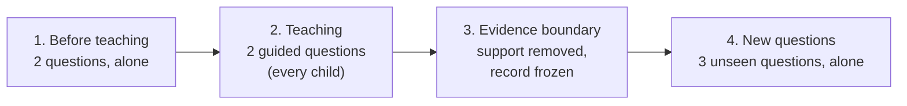

# 2. Proposed Grade 1 Assessment Flow

> DRAFT FOR EXPERT REVIEW. The item counts, order, support levels and timing are proposals, not validated choices.

*(If the diagram does not render: Before teaching → Teaching → Evidence boundary → New questions.)*

**Mathematics concept (draft):** *which of three groups has the most objects.* Every question has three groups and
the child taps one.

## Step by step

| Step | What the child sees and does | Help available | What is recorded | How answers count |
|---|---|---|---|---|
| **1. Before teaching** (2 questions) | Three groups (up to 9 objects); spoken and written instruction; taps the group with the most, then confirms | Only if the child presses **Help** (level 1: instruction repeated more simply) | First answer, time to first answer, answer changes before confirming, instruction replays, any help (level, who started it, start/end time) | Independent only if the record confirms **no help before the first answer**; otherwise "helped" or "unknown" |
| **2. Teaching** (2 questions) | Smaller groups (up to 6) with a standard script: L1 clarify → L2 visual cue → L3 worked demonstration. The next level appears only after an incorrect try. | Built in; this is the teaching | Support levels reached, tries | Always counted as **guided**, never as independent evidence |
| **3. Evidence boundary** | A short transition: "Now three new questions…"; all teaching visuals disappear | — | Boundary time | Everything recorded before this point is frozen. Nothing after it can change it. |
| **4. New questions** (3 questions) | Like step 1: new objects, unseen numbers, correct group in a different position each time | Only if the child presses **Help** | Same as step 1 | Same rule as step 1 |

**At any time:**
- A **break** button pauses the activity. It is recorded with its start and end time; the reason is never asked. A
  break is **not** help.
- Instructions can be **replayed**. If a Sinhala voice is available, audio plays automatically; otherwise the
  instruction is text-only, and audio availability is a review point.
- There is **no timer** on screen, **no score**, and **no "right/wrong"** shown during steps 1 and 4. Neutral
  wording is proposed in [04_sinhala_instructions.md](04_sinhala_instructions.md).
- Tap is the main input. Keyboard and larger targets are available. Drag is not needed for this question type.

## Design choices that need expert review

| Choice | Current draft | Why it is proposed | Review |
|---|---|---|---|
| Teaching for every child | Yes, even if both early questions were right | Avoids a pass/fail routing rule; every child has the same experience | Clinical (D-C01), Educator (D-E09) |
| Number of questions | 2 / 2 / 3 | Three new questions lower the chance of "all correct by guessing" to about 4% | Educator (D-E06), Clinical (D-C03) |
| Answer format | Choose one of three groups | Lowers guessing to 1 in 3 per question (from 1 in 2 in the earlier two-option design) | Educator (D-E03) |
| Transfer timing | Immediately after teaching | Simple to run; but an earlier recorded consultation (R4) asked for **flexible** reassessment timing | Educator (D-E10), Clinical (D-C08) |
| Session length | Not yet measured; the onboarding design targets about 5 minutes for the whole child portion | This probe adds 7 questions to that portion | Educator (D-E07), Clinical (D-C03) |

## What is deliberately *not* recorded

- Audio, video, camera or eye-gaze data.
- Free text typed by the child.
- The reason for a break.
- Exact date of birth, or device identifiers beyond what the app already uses.
- ADHD information or SNAP-IV answers. These are never used by this assessment, neither as inputs nor as labels.

Whether even the recorded fields are minimal enough is a clinical review question (D-C07).
