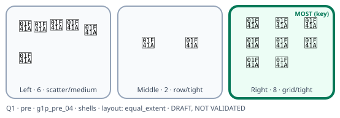
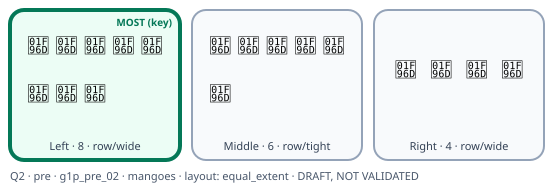
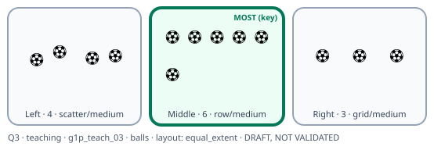
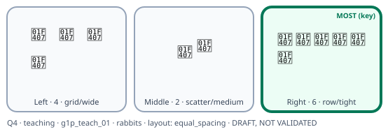
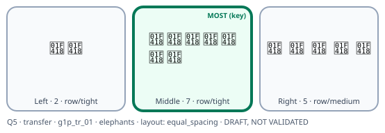
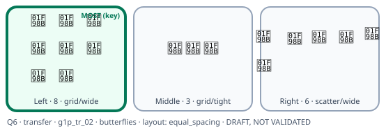
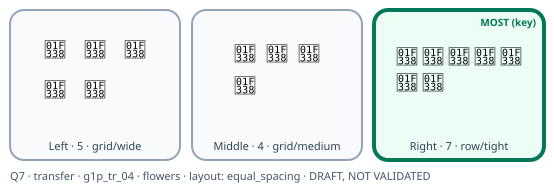

# 3. Illustrated Question Examples (actual synthetic item definitions)

> **UNVALIDATED DRAFT QUESTIONS.** Every item has `expertReview: PENDING`. The pictures are generated by
> `tools/generate_figures.py` from the prototype's own form and item bank. They approximate the planned layouts and
> are **not** the final child interface. The object symbols are placeholders for locally familiar illustrations.

**Source:** form `IMLR-PROBE-G1-F68730132B249`, seed 7 (the same form as the admin IMLR Prototype Demo), item bank
`IMLR-G1-ITEMS-0.1.0-synthetic`.

**How to read the pictures:**
- **Green border + "MOST (key)"** marks the answer key (reviewer copies only).
- Each box is labelled with position · count · pattern/spacing.
- **Child-view** files (no key, no counts) show what a child would see.

## Item design rules (draft)

| Rule | Pre-teaching and new questions | Teaching questions |
|---|---|---|
| Largest group | 7–9 objects | 5–6 objects |
| Largest minus second-largest | exactly 2 | exactly 2 |
| Smallest group | at least 2, smaller than the second | at least 2 |
| Same object type within one question | yes | yes |
| Object size | same for every object | same |
| Correct position | left / middle / right, balanced; each new question uses a different position, and the first new question never repeats the last teaching question's position | distinct positions |
| Arrangement (row / grid / scatter; tight / medium / wide gaps; group fills the box vs equal gaps) | chosen independently of which group is correct | same |
| Never repeated | no question, number set or object type is reused across the three stages | — |

The pre-teaching and new-question pools have the same average largest group (8.0), so their difficulty is intended
to be comparable. **Whether they are actually comparable is an educator question (D-E04).**

---

## The seven questions in the demonstration form

### Before teaching (answered alone)

**Q1 · `g1p_pre_04` · shells · groups 6 / 2 / 8 · answer: Right · layout: group fills the box**

Child view: [figures/child_Q1_g1p_pre_04.svg](figures/child_Q1_g1p_pre_04.svg)

**Q2 · `g1p_pre_02` · mangoes · groups 8 / 6 / 4 · answer: Left · layout: group fills the box**

Child view: [figures/child_Q2_g1p_pre_02.svg](figures/child_Q2_g1p_pre_02.svg)

### Teaching (guided; every child)

**Q3 · `g1p_teach_03` · balls · groups 4 / 6 / 3 · answer: Middle · layout: group fills the box**

**Q4 · `g1p_teach_01` · rabbits · groups 4 / 2 / 6 · answer: Right · layout: equal gaps**

### New questions (transfer; answered alone)

**Q5 · `g1p_tr_01` · elephants · groups 2 / 7 / 5 · answer: Middle · layout: equal gaps**

**Q6 · `g1p_tr_02` · butterflies · groups 8 / 3 / 6 · answer: Left · layout: equal gaps**

**Q7 · `g1p_tr_04` · flowers · groups 5 / 4 / 7 · answer: Right · layout: equal gaps**

In this form the teaching answers are Middle then Right, and the new-question answers are Middle, Left, Right. Each
position is used once in the new questions, and the first new question (Middle) differs from the last teaching
answer (Right).

### Things the research team noticed (for reviewers to judge)
- **Q1:** the correct group (8) is also the group that visually fills its box most. See the density review
  ([07_visual_density_review.md](07_visual_density_review.md)).
- **Q5:** with equal gaps, the 7 elephants take more space than the other groups. The size of the area occupied may
  give the answer away.
- **Objects:** shells, mangoes, elephants, butterflies and others were chosen as neutral, familiar objects. Their
  familiarity and cultural suitability for Sri Lankan Grade 1 children has **not** been checked (D-E08).
- **Counting:** each group is small enough to count one by one. Educators may prefer children to count, to estimate
  at a glance, or either. This affects what the question measures (D-E01).

---

## Full synthetic item bank (13 items)

| Item | Role | Groups (largest, second, smallest) | Object | Review status |
|---|---|---|---|---|
| g1p_pre_01 | pre | 7, 5, 3 | birds | PENDING |
| g1p_pre_02 | pre | 8, 6, 4 | mangoes | PENDING |
| g1p_pre_03 | pre | 9, 7, 5 | leaves | PENDING |
| g1p_pre_04 | pre | 8, 6, 2 | shells | PENDING |
| g1p_teach_01 | teaching | 6, 4, 2 | rabbits | PENDING |
| g1p_teach_02 | teaching | 5, 3, 2 | ducks | PENDING |
| g1p_teach_03 | teaching | 6, 4, 3 | balls | PENDING |
| g1p_tr_01 | transfer | 7, 5, 2 | elephants | PENDING |
| g1p_tr_02 | transfer | 8, 6, 3 | butterflies | PENDING |
| g1p_tr_03 | transfer | 9, 7, 4 | fish | PENDING |
| g1p_tr_04 | transfer | 7, 5, 4 | flowers | PENDING |
| g1p_tr_05 | transfer | 9, 7, 3 | stars | PENDING |
| g1p_tr_06 | transfer | 8, 6, 5 | boats | PENDING |

The positions and arrangements of each group are assigned per child from a recorded seed, so different children see
the same mathematics in different positions and layouts.

**Note for reviewers:** the number sets differ slightly in how far apart the smallest group is (e.g. 7, 5, 2
vs 7, 5, 4). The draft treats these as equally difficult because only the gap between the two largest groups is
controlled. Educators may disagree (D-E04).
