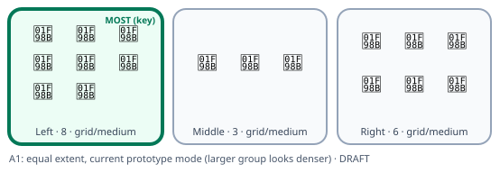
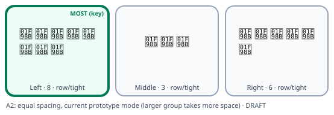
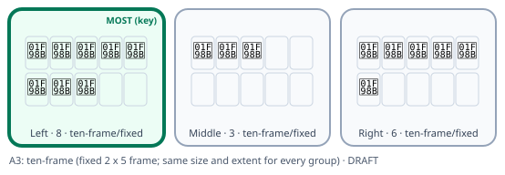
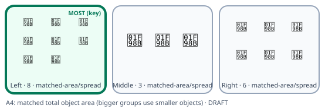

# 7. Visual-Density Confound and Alternative Layouts

> DRAFT FOR EXPERT REVIEW. The figures are generated from transfer item `g1p_tr_02` (butterflies, groups 8 / 6 / 3)
> by `tools/generate_figures.py`. They are illustrations for discussion, not final designs. No layout has been chosen.

## The problem in plain language

The question asks *which group has the most objects*. A child can sometimes pick the right group **without
comparing numbers**, by using a visual impression that happens to go with the larger number:

| Visual cue | Why it can give the answer away |
|---|---|
| **Density** (how crowded a group looks) | If every group fills the same space, the group with more objects is always more crowded |
| **Extent** (how much space a group covers, or how long a row is) | If objects are spaced the same way, the group with more objects always covers more space |
| **Total object area** ("how much stuff") | If all objects are the same size, more objects always means more coloured area |

This matters because the assessment aims to show whether a child can compare **quantities**. If a perceptual
impression is always a reliable shortcut, a correct answer is weaker evidence of that.

**Whether a perceptual impression is an acceptable way for a Grade 1 child to answer is itself an educator
decision (D-E01, D-E05).** Some educators may consider "seeing which is more" a legitimate early skill. Others may
want the question to require counting.

## What the current prototype does (accurately stated)

- Each question uses one of two layout modes, chosen at random and recorded:
  - **Equal extent:** every group fills the same box. The group with the most objects is **always the most
    crowded**, so density fully predicts the answer in these questions.
  - **Equal spacing:** each group's gap (tight / medium / wide) is drawn at random, independently of the answer. The
    space a group covers is **often, but not always**, largest for the correct group.
- Object size is the same for every object, so **total object area always goes with the number**, in both modes.
- Pattern (row / grid / scatter), gap and correct position are drawn independently of the answer. Automated tests
  confirm this independence for **those** variables, but they do **not** remove the density and area cues above.

This limitation is already stated in the admin IMLR Prototype Demo's limitations section.

## Alternative layouts (illustrated)

### A1: Equal extent (current mode)

- **Controls:** extent (all groups the same size).
- **Remaining cues:** density and total area both point to the answer.

### A2: Equal spacing (current mode)

- **Controls:** density (same gaps).
- **Remaining cues:** extent and total area usually point to the answer.

### A3: Ten-frame (fixed 2 × 5 frame)

- **Controls:** the frame's size and shape are identical for every group.
- **Remaining cues:** total area still points to the answer (more filled slots).
- **Construct risk:** the familiar structure (rows of five) makes counting easy, which may be desirable or may turn
  the task into "reading a ten-frame".
- **Range limit:** works only up to 10.

### A4: Matched total object area

- **Controls:** total object area (larger groups use smaller objects).
- **New conflict:** object **size** now runs against number. Young children may choose the group with the bigger
  objects.
- **Accessibility:** small objects at 8–9 may be hard to see.

### A5: Mixed controls across questions (no figure; a design rule)
- Within a set of questions, deliberately include some where the cues **agree** with the answer and some where they
  **disagree**. For example, the largest group packed tightly in a small space while a smaller group is spread
  widely.
- Each question records which cues were congruent, so results can be checked for cue-following.
- **Cost:** needs more questions, or a larger pool to draw from, to balance congruent and incongruent trials. It also
  makes some questions harder in a way that may not be desired at Grade 1.
- Balancing congruent and incongruent visual cues is an established approach in non-symbolic number research. The
  team should confirm the specific references before citing them.

### A6: Other options (for educators to suggest)
- **Count-then-compare** with number labels shown after counting. This changes the construct towards symbolic
  comparison.
- **Sequential presentation** (objects appear one at a time). This raises the memory demand and is a clinical
  concern.
- A different response format, such as "build a group with more" (see form 5, C2).

## Summary table

| Layout | Density cue | Extent cue | Total-area cue | Main risk | Extra items needed |
|---|---|---|---|---|---|
| A1 equal extent (current) | **always** points to answer | controlled | **always** | perceptual shortcut | no |
| A2 equal spacing (current) | controlled | **usually** | **always** | perceptual shortcut | no |
| A3 ten-frame | controlled | controlled | **always** | construct shift; max 10 | no |
| A4 matched area | varies | varies | controlled | size conflict; small objects | no |
| A5 mixed controls | balanced | balanced | balanced (needs size variation) | harder; more items | **yes** |

**Research-team note, not a decision:** if educators want the question to require counting, A3 or A5 seem worth
piloting. If educators accept perceptual comparison as a valid Grade 1 skill, the current modes may be acceptable,
with the limitation stated in all reporting. The final choice belongs to the educators (D-E05). Possible
distraction effects are for the clinical supervisor (form 6, A3).

## Review questions
- **Educators:** form 5, section D (D1–D4).
- **Clinical supervisor:** form 6, A3 (distraction) and E3 (visual accessibility).
